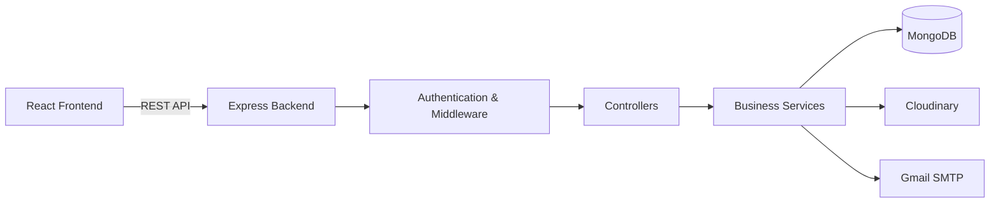
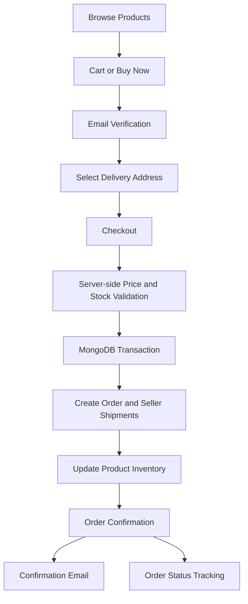

# ShopSphere

A full-stack multi-vendor e-commerce marketplace built using the MERN stack, featuring secure authentication, product management, shopping cart, checkout and reliable order processing.


## Overview

ShopSphere is a multi-vendor e-commerce platform designed to connect customers and sellers through a single marketplace.

The platform enables customers to discover products, manage shopping carts, save wishlists and place orders, while sellers can manage their product listings, pricing and inventory.

The project focuses on real-world e-commerce workflows, secure backend architecture, data consistency and maintainable full-stack development.

## Key Features

### Authentication & Authorization

- User registration and login
- JWT-based authentication
- Access and refresh token management
- Refresh token rotation
- Role-based access control
- Gmail SMTP email verification
- Forgot and reset password functionality
- Protected routes and session management
- Email verification resend with cooldown

### Product Marketplace

- Product browsing and category navigation
- Product search with autocomplete suggestions
- Advanced filtering, sorting and pagination
- Product details and image galleries
- Discount and stock availability management
- Cloudinary image storage

### Customer Experience

- Shopping cart management
- Wishlist management
- Multiple delivery addresses
- Buy Now functionality
- Checkout with server-calculated pricing
- Cash on Delivery
- Order confirmation emails
- Order history and details
- Order status tracking
- Order cancellation

### Seller Experience

- Role-protected seller workspace
- Create, update and delete product listings
- Product image uploads
- Product pricing and inventory management
- Product visibility management
- Ownership-based product access

### Security

- Password hashing using bcrypt
- HttpOnly cookie-based authentication
- CSRF protection
- API rate limiting
- Account lockout protection
- Zod request validation
- NoSQL injection mitigation
- Secure email verification tokens
- Resource ownership validation

## Tech Stack

| Category | Technologies |
|---|---|
| Frontend | React.js, Vite, Tailwind CSS |
| State Management | Redux Toolkit, React Redux |
| Routing | React Router |
| Backend | Node.js, Express.js |
| Database | MongoDB, Mongoose |
| API | REST APIs, Axios |
| Authentication | JWT, bcrypt |
| Media Storage | Cloudinary, Multer |
| Email Service | Nodemailer, Gmail SMTP |
| Validation | Zod |
| Security | Helmet, CORS, CSRF Protection |
| Testing | Supertest, Postman, Node.js Test Runner |
| Version Control | Git, GitHub |

## System Architecture



The application follows a modular architecture with separate frontend and backend layers, reusable components, centralized middleware and service-based business logic.

## Order Processing Workflow



## Engineering Highlights

### Transaction-Based Order Processing

Uses MongoDB transactions to maintain data consistency during order creation, inventory updates and order cancellation.

### Idempotent Order Creation

Uses idempotency keys to prevent duplicate orders and repeated inventory deductions when requests are retried.

### Inventory Management

Uses atomic stock updates to prevent overselling and automatically restores inventory when eligible orders are cancelled.

### Multi-Vendor Order Architecture

Separates customer orders into seller-specific shipment records, allowing independent shipment status and shipping charge management.

### Server-Side Pricing

Calculates product prices, discounts, shipping charges and order totals on the backend to prevent client-side price manipulation.

### Order Data Integrity

Preserves product information, prices and delivery address snapshots to maintain accurate historical order records.

### Secure Authentication

Implements refresh token rotation, hashed verification tokens, session revocation and role-based resource authorization.

## Project Structure

```text
shopsphere/
├── client/
│   └── src/
│       ├── components/
│       ├── pages/
│       ├── layouts/
│       ├── routes/
│       ├── redux/
│       ├── services/
│       ├── hooks/
│       └── utils/
│
├── server/
│   ├── src/
│   │   ├── config/
│   │   ├── controllers/
│   │   ├── middleware/
│   │   ├── models/
│   │   ├── routes/
│   │   ├── services/
│   │   ├── validators/
│   │   ├── scripts/
│   │   └── utils/
│   └── tests/
│
├── docs/
└── package.json
```

## Core Database Models

| Model | Responsibility |
|---|---|
| User | User accounts and authentication |
| RefreshSession | Refresh token and session management |
| SellerProfile | Seller and store information |
| Category | Product categories |
| Product | Product details and inventory |
| Cart | Customer shopping cart |
| Wishlist | Saved products |
| Address | Customer delivery addresses |
| Order | Customer order information |
| SellerOrder | Seller-specific order shipments |

## Development Roadmap

- [x] Phase 1 — Project foundation
- [x] Phase 2 — Authentication and role-based access
- [x] Phase 3 — Product marketplace
- [x] Phase 4 — Cart, wishlist, checkout and orders
- [ ] Phase 5 — Seller dashboard, fulfilment and reviews
- [ ] Phase 6 — Admin dashboard and moderation
- [ ] Phase 7 — Online payments, webhooks and refunds
- [ ] Phase 8 — Final testing and deployment

## Upcoming Features

- Advanced seller dashboard
- Seller order fulfilment
- Product ratings and reviews
- Admin management dashboard
- Seller approval system
- Razorpay payment integration
- Payment webhooks
- Refund management
- Sales analytics
- Production deployment

## Project Status

Currently under active development.

Phase 4 has been implemented, including the customer shopping workflow, email-verified checkout, Cash on Delivery and transaction-based order management.

The next development phase focuses on seller operations, order fulfilment and product reviews.

## Developer

**Dipak Hore**

Full-Stack Development | AI/ML

- [GitHub](https://github.com/dipakhore-dev)
- [LinkedIn](https://www.linkedin.com/in/dipak-hore/)
